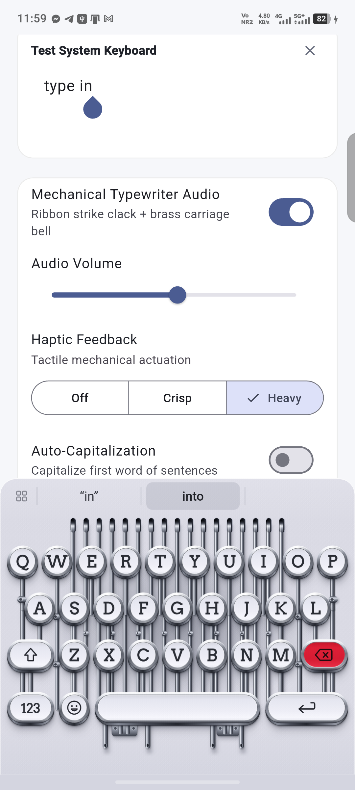

<div align="center">
  
  <h1>Typewriter</h1>
  <p>
    <strong>An open-source mechanical typewriter keyboard for Android (IME &amp; Companion App) paired with a scroll-driven Three.js 3D CAD showcase.</strong>
  </p>

  <p>
    <a href="https://the-habib.github.io/Typewriter/">Live 3D Showcase</a> •
    <a href="https://github.com/The-habib/Typewriter/releases">Android APK Releases</a> •
    <a href="#monorepo-structure">Monorepo Structure</a> •
    <a href="#quick-start">Quick Start</a> •
    <a href="CONTRIBUTING.md">Contributing</a>
  </p>

  <p>
    
    
    
    
  </p>
</div>

---

## Overview

**Typewriter** brings the tactile craft of a vintage mechanical typewriter to modern Android devices—without sacrificing speed, ergonomics, or privacy.

This repository is a unified **open-source monorepo** containing both:
1. **`app/`** — The full **Android Keyboard (`InputMethodService`) & Companion App**, built with **Flutter** and **Kotlin**.
2. **`web/`** — The interactive **3D Showcase & Landing Page**, built with **React**, **Three.js**, **custom GLSL shaders**, and **Tailwind CSS**.

---

## Screenshots

<p align="center">
  
  &nbsp;&nbsp;
  
  &nbsp;&nbsp;
  
</p>

---

## Key Features

### Android Keyboard & Companion App (`app/`)
- **32-Key Mechanical Geometry**: 26 circular porcelain-dish letter keys and 6 wide pill modifiers (`Shift`, `123/#+=`, `Emoji`, `Space`, `Return`, crimson `Backspace`) across `ABC`, `123`, and `#+=` layers.
- **Real-Time Spring Kinematics**: Committed 44 ms strike plunge, 46 ms dwell, and 118 ms spring return (`56 / 54 / 145 ms` on heavy keys) with 17 steel lever bars, sympathetic adjacent bar tremor, twin 12-turn Spacebar coil springs, and a `0.25×` slow-motion inspection mode.
- **3 Mechanism Render Modes**: Switch live between **Classic** (porcelain enamel caps), **Crystal** (translucent sapphire X-ray), and **Blueprint** (exposed steel undercarriage).
- **7 Sampled WAV Audio Strikes + 3 Haptic Tiers**: Native Android `SoundPool` playback (`key_strike_1..4.wav`, `key_backspace.wav`, `key_space_return.wav`, `key_mode.wav`) with natural pitch variation plus **Off**, **Crisp**, and **Heavy** tactile haptics.
- **4,770-Word Offline Prediction & Autocorrect**: Real-time 3-slot prediction bar, typo/contraction autocorrect on Space with immediate Backspace undo, bigram suggestions, and local word learning.
- **Modern Typing Gestures & Drawers**: Hold & slide Spacebar cursor trackpad, swipe-left on Backspace to delete whole words, double-space period, chorded Shift/123 drags, long-press accent alternates, categorized Emoji drawer, 15-item Clipboard history, and Android Voice Recognition.
- **100% Private & Offline**: Zero analytics, zero internet permission in the IME, and all learned words and clipboard items stay strictly on-device.

### Interactive 3D Showcase (`web/`)
- **5-Chapter Scroll Choreography**: Scrub smoothly from top-down overview to rear comb hooks, gimbal guides, twin Spacebar springs, and a 6-tier exploded assembly.
- **Interactive CAD Workbench**: Orbit freely, inspect individual parts, switch 4 brushed-metal finishes (`Dark Steel`, `Raw Silver`, `Matte Black`, `Warm Brass`), toggle `Full Keys / Split X-Ray / Inside View`, type directly on your physical keyboard, and hear the real sampled WAV keystrikes.
- **Custom GLSL Shaders**: Turned chrome bezel anisotropic highlights, concave porcelain enamel micro-grain, and a single-draw-call 32-key dynamic SDF contact shadow shader.

---

## Monorepo Structure

```text
Typewriter/
├── app/                     # Flutter + Kotlin Android Keyboard (IME) & Companion App
│   ├── android/             # Native InputMethodService, SoundPool audio & haptic engine
│   ├── assets/              # Logo, Arvo font, 4,770-word English dictionary
│   ├── lib/                 # Dart keyboard renderer, spring physics, predictions & companion UI
│   └── test/                # Unit & widget tests
├── web/                     # React + Three.js + Tailwind Landing Page & 3D Showcase
│   ├── public/              # Favicons, PWA manifest, OG image, sitemap, WAV audio, screenshots
│   └── src/                 # 3D CAD assembly, GLSL shaders, scroll choreography & UI
├── docs/                    # Curated screenshots & brand assets
├── .github/                 # CI/CD workflows (Flutter CI, Web CI, GitHub Pages) & templates
├── LICENSE                  # MIT License
├── CONTRIBUTING.md
├── CODE_OF_CONDUCT.md
└── SECURITY.md
```

---

## Quick Start

### 1. Run or Build the Android Keyboard (`app/`)

**Prerequisites:** Flutter SDK (`>= 3.x`, Dart `^3.14.0`), Android SDK, Java 17.

```bash
cd app
flutter pub get
flutter analyze
flutter test
flutter build apk --release
```

Install the generated APK on a connected Android device:

```bash
flutter install --release
```

Then open **Typewriter** on your phone and follow the 2-step setup card:
1. Enable **Typewriter** in Android *Languages & Input*.
2. Select **Typewriter** as your active system keyboard.

### 2. Run the 3D Landing Page (`web/`)

**Prerequisites:** Node.js `>= 20` (or Bun `>= 1.1`).

```bash
cd web
npm install
npm run dev
```

Run typechecks, unit tests, and production build:

```bash
cd web
npm run lint
bun test
npm run build
```

---

## Deploying the Landing Page (GitHub Pages)

This repository includes `.github/workflows/deploy-pages.yml` to automatically build `web/` and publish it to GitHub Pages whenever `main` is updated.

To enable it on GitHub:
1. Open **Settings → Pages** in `The-habib/Typewriter`.
2. Set **Source** to **GitHub Actions**.
3. Push to `main` (or trigger the **Deploy Landing Page to GitHub Pages** workflow manually).

---

## Contributing & Community

Contributions, bug reports, keyboard layout ideas, and shader improvements are welcome!
- Read [CONTRIBUTING.md](CONTRIBUTING.md) before opening a pull request.
- Follow our [CODE_OF_CONDUCT.md](CODE_OF_CONDUCT.md).
- Report security issues privately via [SECURITY.md](SECURITY.md).

---

## License

Released under the [MIT License](LICENSE) — free to use, study, modify, and distribute.
