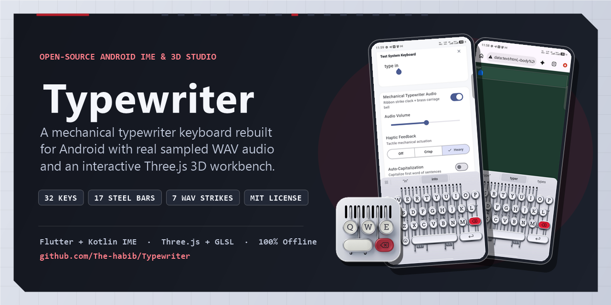
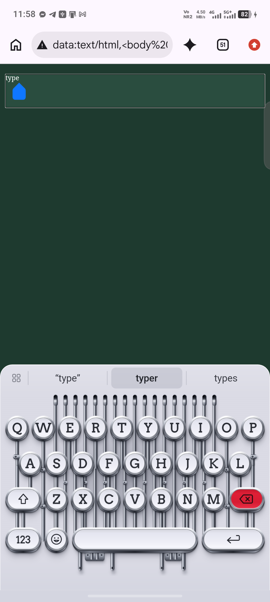
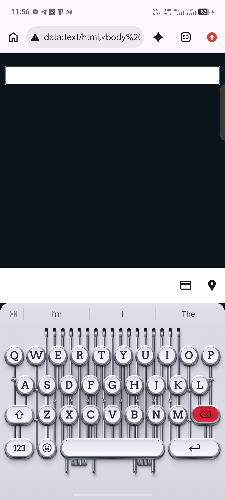

<div align="center">
  <a href="https://github.com/The-habib/Typewriter">
    
  </a>

  <br /><br />

  <h1>Typewriter</h1>
  <p>
    <strong>A mechanical typewriter keyboard for Android (Flutter + Kotlin IME &amp; Companion App) paired with a scroll-driven Three.js 3D CAD showcase.</strong>
  </p>

  <p>
    <a href="https://the-habib.github.io/Typewriter/">Live 3D Showcase</a> &bull;
    <a href="https://github.com/The-habib/Typewriter/releases/latest">Download Android APK</a> &bull;
    <a href="#screenshots">Screenshots</a> &bull;
    <a href="#monorepo-structure">Monorepo</a> &bull;
    <a href="#quick-start">Quick Start</a> &bull;
    <a href="CONTRIBUTING.md">Contributing</a>
  </p>

  <p>
    <a href="https://github.com/The-habib/Typewriter/actions/workflows/flutter-ci.yml">
      
    </a>
    <a href="https://github.com/The-habib/Typewriter/actions/workflows/web-ci.yml">
      
    </a>
    <a href="https://github.com/The-habib/Typewriter/releases/latest">
      
    </a>
    <a href="LICENSE">
      
    </a>
  </p>

  <p>
    
    
    
    
  </p>
</div>

---

## Why Typewriter?

Most retro keyboard skins are flat static images pasted onto a soft keyboard. **Typewriter** models the entire mechanical deck—**32 sculpted porcelain-and-chrome keys**, **17 steel lever bars**, **split gimbal guides**, and **twin 12-turn Spacebar coil springs**—with real spring-damper physics and sampled mechanical WAV strikes.

This repository is a unified **open-source monorepo** containing both:
1. **[`app/`](app/)** — The native **Android Keyboard (`InputMethodService`) & Companion Settings App** written in **Flutter + Kotlin**.
2. **[`web/`](web/)** — The **Interactive 3D CAD Showcase & Landing Page** written in **React 19 + Three.js + custom GLSL shaders**.

---

## Screenshots

<div align="center">
  <table>
    <tr>
      <td align="center" width="33%">
        
        <br />
        <sub><strong>Companion App &amp; Live IME</strong><br />Guided setup, audio volume, haptics &amp; test box</sub>
      </td>
      <td align="center" width="33%">
        
        <br />
        <sub><strong>3-Slot Predictive Ribbon</strong><br />4,770-word offline corpus &amp; autocorrect</sub>
      </td>
      <td align="center" width="33%">
        
        <br />
        <sub><strong>System-Wide Integration</strong><br />Porcelain caps, chrome rings &amp; crimson ⌫</sub>
      </td>
    </tr>
  </table>
</div>

---

## Key Features

<table>
  <tr>
    <td valign="top" width="50%">
      <h3>Android Keyboard &amp; Companion (<code>app/</code>)</h3>
      <ul>
        <li><strong>32-Key Mechanical Layout:</strong> 26 circular porcelain-dish keys + 6 wide pill modifiers across <code>ABC</code>, <code>123</code>, and <code>#+=</code> layers.</li>
        <li><strong>Real-Time Kinematics:</strong> 44 ms plunge, 46 ms dwell, and 118 ms spring return (56 / 54 / 145 ms on heavy keys) with 17 steel bars &amp; adjacent bar tremor.</li>
        <li><strong>3 Live Render Modes:</strong> Switch between <strong>Classic</strong>, <strong>Crystal</strong> (X-Ray), and <strong>Blueprint</strong> (undercarriage), plus <code>0.25&times;</code> Slow-Mo inspection.</li>
        <li><strong>7 Sampled WAVs + 3 Haptics:</strong> Low-latency native <code>SoundPool</code> playback with pitch variation + <em>Off</em>, <em>Crisp</em>, and <em>Heavy</em> tactile actuation.</li>
        <li><strong>Smart Offline Typing:</strong> 4,770-word dictionary, 3-slot predictions, autocorrect on Space with Backspace undo, bigrams &amp; local word learning.</li>
        <li><strong>Power Gestures &amp; Drawers:</strong> Spacebar cursor trackpad, swipe-left Backspace word delete, chorded Shift/123 drag, long-press accents, Emoji drawer, 15-item Clipboard, and Voice input.</li>
      </ul>
    </td>
    <td valign="top" width="50%">
      <h3>Interactive 3D Web Showcase (<code>web/</code>)</h3>
      <ul>
        <li><strong>5-Chapter Scroll Choreography:</strong> Smoothly glides from top-down overview to rear comb hooks, keycap guides, twin Spacebar springs, and a 6-tier exploded view.</li>
        <li><strong>Interactive CAD Workbench:</strong> 5 camera presets, free orbit, click-to-inspect part telemetry, <code>Full Keys / Split X-Ray / Inside View</code>, and live physical keyboard typing.</li>
        <li><strong>4 Brushed-Metal Finishes:</strong> Switch live between <em>Dark Steel</em>, <em>Raw Silver</em>, <em>Matte Black</em>, and <em>Warm Brass</em>.</li>
        <li><strong>Custom GLSL Shaders:</strong> Anisotropic turned chrome bezels, concave porcelain enamel micro-grain, and a single-draw-call 32-key SDF dynamic contact shadow shader.</li>
        <li><strong>Hybrid Sampled Audio:</strong> Plays the exact 7 mechanical WAV recordings from the Android app with procedural Web Audio fallback.</li>
      </ul>
    </td>
  </tr>
</table>

<details>
<summary><strong>Explore Typing Gestures, Shortcuts &amp; Technical Architecture</strong></summary>

<br />

| Gesture / Input | Behavior in Android IME |
| :--- | :--- |
| **Hold &amp; Slide Spacebar** | Precision cursor trackpad (moves cursor left/right character by character) |
| **Double-Tap Spacebar** | Inserts `. ` with smart capitalization on the next sentence |
| **Swipe Left on Backspace (`⌫`)** | Deletes whole words before cursor (`deleteWordBeforeCursor`) |
| **Immediate Backspace after Autocorrect** | Undoes the autocorrection and restores your raw typed word |
| **Chorded Shift / `123` Drag** | Press Shift or `123`, slide onto any target key, and release to commit &amp; return |
| **Long-Press Letter Key** | Opens accented character alternates popup |
| **Quick Studio Menu (`⊞`)** | Toggle `Classic / Crystal / Blueprint`, open Clipboard (15 clips), Voice input, or Companion settings |

</details>

---

## Monorepo Structure

```text
Typewriter/
├── .github/                 # CI/CD workflows (Flutter APK CI, Web CI, GitHub Pages) & templates
├── app/                     # Flutter + Kotlin Android Keyboard (IME) & Companion App
│   ├── android/             # Native TypewriterInputMethodService, SoundPool audio & haptic engine
│   ├── assets/              # App logo, Arvo font, 4,770-word English corpus (en_common.txt)
│   ├── lib/                 # Dart CustomPainter deck, spring physics, predictions & companion UI
│   └── test/                # Unit & widget test suite (8 tests)
├── web/                     # React 19 + Three.js + Tailwind Landing Page & 3D Workbench
│   ├── public/              # Favicons, PWA manifest, OG thumbnail, sitemap, WAVs, screenshots
│   └── src/                 # Parametric 3D CAD assembly, GLSL shaders, kinematics & UI
├── docs/                    # Repository banner, brand logo & curated Android screenshots
├── LICENSE                  # MIT License
├── CONTRIBUTING.md
├── CODE_OF_CONDUCT.md
├── SECURITY.md
└── CHANGELOG.md
```

---

## Quick Start

### 1. Install or Build the Android App (`app/`)

- **Fastest way:** Download the prebuilt APK from [**Latest Releases**](https://github.com/The-habib/Typewriter/releases/latest) and install it on Android.
- **Build from source** (requires Flutter `>= 3.x`, Dart `^3.14.0`, Android SDK, Java 17):

```bash
git clone https://github.com/The-habib/Typewriter.git
cd Typewriter/app
flutter pub get
flutter analyze
flutter test
flutter build apk --release
```

After installing, open **Typewriter** on your Android device and follow the 2-step setup card:
1. Tap **Enable** to turn on *Typewriter* in Android **Languages &amp; Input**.
2. Tap **Select** to switch your active system keyboard to *Typewriter*.

### 2. Run the 3D Web Showcase (`web/`)

```bash
cd Typewriter/web
npm install
npm run dev       # Local dev server
npm run lint      # TypeScript typecheck
bun test          # Kinematic & scroll choreography tests
npm run build     # Production build -> dist/
```

---

## Contributing, Privacy &amp; License

- **100% On-Device Privacy:** The Android IME has no analytics, no keystroke telemetry, and no network tracking. See [SECURITY.md](SECURITY.md).
- **Contributions Welcome:** Check [CONTRIBUTING.md](CONTRIBUTING.md) and our [CODE_OF_CONDUCT.md](CODE_OF_CONDUCT.md) before opening a PR.
- **License:** Released under the [MIT License](LICENSE).

<div align="center">
  <br />
  <a href="https://github.com/The-habib/Typewriter/stargazers">
    <strong>If you like Typewriter, consider starring the repository!</strong>
  </a>
</div>
